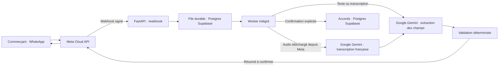

# Architecture du bot

## Un seul parcours

Le menu propose nouvel accord, consultation et aide. Un vocal suit le même parcours qu’un texte après transcription. Les valeurs sont proposées dans un brouillon ; elles ne deviennent un accord qu’après confirmation du commerçant. Le calcul du reste et la validation des montants sont déterministes.

Les audios reçus sont téléchargés directement depuis Meta, vérifiés puis transmis en mémoire à Gemini sous forme de données intégrées encodées en base64. La limite de 14 000 000 octets laisse de la place à cet encodage et au texte de la requête. Les fichiers audio sont conservés dans le bucket privé Supabase `MEDIA_BUCKET`, sous un nom dérivé du message et de son empreinte ; les métadonnées et transcriptions sont reliées dans la base. La transcription est demandée en français et renvoyée sur WhatsApp ; l’extraction utilise une réponse JSON structurée.

## Frontières de confiance

- Meta est contrôlé par signature du corps HTTP avant traitement. Le secret de validation GET protège uniquement l’enregistrement initial du webhook.
- La liste `ALLOWED_SENDERS` autorise les commerçants ; les clients référencés peuvent gérer leur consentement et leurs vocaux, sans accéder aux actions du commerçant. La séparation des accords s’appuie sur l’expéditeur WhatsApp.
- Les sorties du modèle restent des données à valider. Une transcription n’est pas une validation du commerçant.
- Les tokens restent dans l’environnement. Les secrets, copies de la base et enregistrements audio n’entrent pas dans le dépôt ni dans l’image Docker.

## Exploitation

Lancer **une seule instance et un seul worker Uvicorn**. La base est dans Postgres (Supabase) et les audios dans un bucket privé : le conteneur ne garde rien, la machine peut s’arrêter quand la file est vide. Les réservations de la file passent par un verrou consultatif Postgres ; le connecteur Mac garde toutefois ses tâches en mémoire, ce qui interdit encore plusieurs instances.

La livraison des messages traverse plusieurs services : une erreur réseau peut rendre l’état d’un envoi incertain. Ne pas promettre une livraison exactement une fois. Contrôler les tests de déduplication et les états d’erreur avant une utilisation plus large.

Pour une copie de la base : `pg_dump --schema=wuumtaaba`. Voir [la base](DATABASE.md).

`RETENTION_DAYS` configure la durée de rétention technique utilisée par l’application ; vérifier les catégories effectivement purgées dans le stockage avant de formuler un engagement de suppression des données. La suppression complète d’un compte et une interface d’administration ne font pas partie de cette V1.

## Validation

Les tests automatisés isolent les fournisseurs. Ils doivent couvrir le webhook signé, les doublons, les brouillons incomplets, les montants, les confirmations, la séparation par expéditeur et les erreurs audio. La recette dans [SETUP_META.md](SETUP_META.md) valide ensuite le réseau, les autorisations Meta, la transcription et l’affichage réel sur WhatsApp.

Le [schéma de la base](DATABASE.md) décrit le journal des interactions, les échéances et les rappels conditionnés au consentement.
