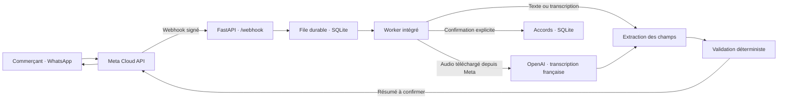

# Architecture V1

## Un seul parcours

Le menu propose nouvel accord, consultation et aide. Un vocal suit le même parcours qu’un texte après transcription. Les valeurs sont proposées dans un brouillon ; elles ne deviennent un accord qu’après confirmation du commerçant. Le calcul du reste et la validation des montants sont déterministes.

## Frontières de confiance

- Meta est contrôlé par signature du corps HTTP avant traitement. Le secret de validation GET protège uniquement l’enregistrement initial du webhook.
- La liste `ALLOWED_SENDERS` ferme le pilote aux autres expéditeurs. La séparation des accords s’appuie sur l’expéditeur WhatsApp.
- Les sorties du modèle restent des données à valider. Une transcription n’est pas une validation du commerçant.
- Les tokens restent dans l’environnement. Les secrets, bases SQLite et enregistrements audio n’entrent pas dans le dépôt ni dans l’image Docker.

## Exploitation

Lancer **une seule instance et un seul worker Uvicorn**. La base est persistée dans `data/` en local et `/app/data` en conteneur. Une ouverture à plusieurs instances nécessiterait une file partagée, un stockage adapté et une revue de la concurrence.

La livraison des messages traverse plusieurs services : une erreur réseau peut rendre l’état d’un envoi incertain. Ne pas promettre une livraison exactement une fois. Contrôler les tests de déduplication et les états d’erreur avant une utilisation plus large.

Sauvegarder la base avec l’API de sauvegarde SQLite ou arrêter proprement le service avant de copier le stockage. Ne pas copier uniquement le fichier principal pendant une écriture sans prendre en compte le journal SQLite.

`RETENTION_DAYS` configure la durée de rétention technique utilisée par l’application ; vérifier les catégories effectivement purgées dans le stockage avant de formuler un engagement de suppression des données. La suppression complète d’un compte et une interface d’administration ne font pas partie de cette V1.

## Validation

Les tests automatisés isolent les fournisseurs. Ils doivent couvrir le webhook signé, les doublons, les brouillons incomplets, les montants, les confirmations, la séparation par expéditeur et les erreurs audio. La recette dans [SETUP_META.md](SETUP_META.md) valide ensuite le réseau, les autorisations Meta, la transcription et l’affichage réel sur WhatsApp.
